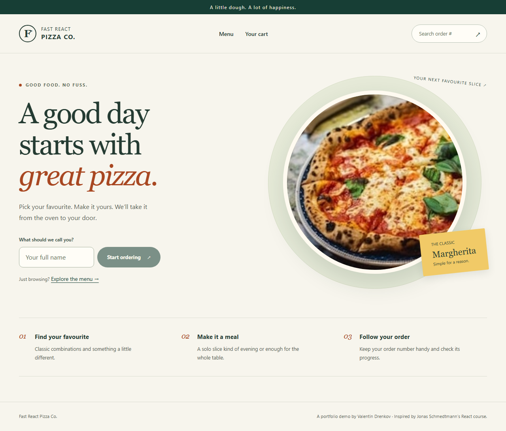

# Fast React Pizza

A responsive pizza-ordering demo built with React, strict TypeScript and React Router data APIs. Browse the menu, manage quantities, place a demo order and track its status.

[Hosted demo](https://fast-react-pizza-vdrenkov.netlify.app/)



## Run locally

Use Node.js **26.13.0** (see `.nvmrc`).

```bash
npm ci
npm run dev
```

Open the local URL printed by Vite. To serve the production build:

```bash
npm run build
npm run preview
```

## Features

- Responsive menu cards, sold-out states and labelled quantity controls.
- Cart totals, checkout validation and a transparent 20% priority surcharge.
- Optional location lookup with manual address entry and permission-error handling.
- Order lookup, delivery estimates, manual status refresh and priority upgrades.
- Recoverable network errors, request timeouts, cancelled navigation requests and runtime API validation.
- Keyboard navigation, skip link, route focus management and reduced-motion support.

## Stack and structure

React 19 · React Router 8 · Redux Toolkit 2 · TypeScript 6 · Vite 8 · Tailwind CSS 4 · Zod 4.

`src/features` groups cart, menu, order and user code. Redux owns cart and customer state; route loaders and actions handle remote data and mutations. `src/services` validates external responses against schemas in `src/types.ts`. `src/ui` contains shared layout and controls.

TypeScript stays on the latest 6.0 release supported by `typescript-eslint`. The `minimatch` override supplies the patched 11.x release for the lint toolchain; remove it when upstream dependencies adopt that release. Lockfiles are generated by npm.

## Verification

```bash
npm run lint
npm run format:check
npm run test:coverage
npm run build
npm audit --audit-level=low
npx playwright install chromium firefox webkit
npm run test:e2e
```

Vitest and Testing Library cover reducers, API contracts, validation, routing and complete component flows. Coverage gates require 90% statements and lines, 80% branches and 85% functions. Playwright runs ordering, error, location, keyboard and axe accessibility checks in Chromium, Firefox, WebKit and a mobile Chromium viewport. Browser tests use controlled API responses and exercise the production build; they do not verify the public service's availability.

GitHub Actions runs these checks on pushes and pull requests. Dependabot checks npm dependencies and pinned GitHub Actions weekly. Coverage and browser reports are retained as CI artifacts.

For a local SonarQube analysis, run the coverage command first, start a local SonarQube server, set `SONAR_HOST_URL` and `SONAR_TOKEN`, and run SonarScanner from the repository root. `sonar-project.properties` includes production code, tests and coverage. Use a disposable local server for reviews.

## Demo boundaries

The app uses Jonas Schmedtmann's public [pizza API](https://react-fast-pizza-api.jonas.io/api/menu), its hosted pizza images and BigDataCloud reverse geocoding. It has no private backend, authentication, payment processing or real delivery. Use fictional contact details: submitted orders go to a public teaching service. Location access is requested only after selecting **Use my location**; the geocoding provider receives those coordinates. Review the suggested area and enter a full street address before submitting.

Cart and customer state stay in memory and reset on page reload. Keep the order number to retrieve an existing order. The public API controls prices and status, and provides no client-controlled idempotency guarantee; a failed confirmation does not prove that an order was never created. No automatic mutation retries run.

## Deployment

Build with `npm ci && npm run build` and publish `dist`. Netlify reads the SPA fallback in `public/_redirects` and security headers in `public/_headers`. Configure equivalent fallback and headers on other hosts. Geolocation needs HTTPS outside localhost. Deployment is separate from local verification.

## Attribution

Based on **The Ultimate React Course** by Jonas Schmedtmann. The pizza domain, public teaching API and images originate from the course. This repository extends that foundation with TypeScript, API validation, accessibility, a revised interface, regression coverage and CI. It is a learning and portfolio project.
